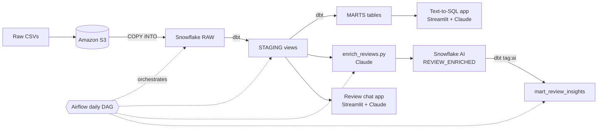

# AI-Powered Food Delivery Analytics Pipeline

> 🚧 **Work in progress.** This project is under active development; models, docs, and structure may change.

An end-to-end data engineering project for a food delivery platform (Zomato-style). Raw order, restaurant, customer, menu and review data lands in **Amazon S3**, is loaded into **Snowflake**, transformed into a tested star schema with **dbt**, orchestrated daily with **Apache Airflow**, and enriched with **Claude** (Anthropic's LLM). Two **Streamlit** apps let anyone ask questions of the data in plain English.

## What it does

- **Ingests ~2.3 GB of raw CSV data** (7 datasets, millions of orders) from an S3 stage into Snowflake with `COPY INTO`.
- **Cleans messy source data** in dbt staging models. Ratings like `--` become NULL, `₹ 300` becomes `300`, `"Ameerpet,Hyderabad"` becomes `Hyderabad`, and IDs are cast safely with `try_to_number`.
- **Builds a star schema** of fact and dimension tables plus business marts: daily city revenue (GMV, AOV, cancel rate), delivery SLA (p50/p90 delivery time by city and hour) and restaurant performance.
- **Loads facts incrementally** with a merge strategy, so daily runs only process new orders.
- **Tests data quality** with dbt tests: uniqueness, not-null, accepted values and referential integrity.
- **Classifies customer reviews with Claude**: sentiment label, sentiment score, topic and the key issue, returned as schema-validated JSON and written back to Snowflake.
- **Answers questions in plain English**:
  - *Text-to-SQL app.* Ask "Average delivery time by city, worst first"; Claude writes a `SELECT` query, Snowflake runs it, and the app shows the table and a chart.
  - *Review chat app.* Ask "What do customers complain about most?"; Claude reads a sample of reviews and answers with citations to the exact reviews it used.

## Architecture



The Airflow DAG `zomato_batch` runs daily:

```
reload_raw  →  dbt_build_core  →  enrich_reviews  →  dbt_build_ai
```

| Task | What it does |
|---|---|
| `reload_raw` | `COPY INTO` each RAW table from the S3 stage. Snowflake skips files it has already loaded, so re-runs don't create duplicates. |
| `dbt_build_core` | `dbt build --exclude tag:ai` runs and tests every staging and mart model. |
| `enrich_reviews` | Sends new, not-yet-classified reviews to Claude and saves the labels to `ZOMATO.AI.REVIEW_ENRICHED`. |
| `dbt_build_ai` | `dbt build --select tag:ai` builds `mart_review_insights` on top of the AI output. |

## Tech stack

| Layer | Tools |
|---|---|
| Storage | Amazon S3, Snowflake (storage integration and external stage) |
| Transformation | dbt Core 1.8 + dbt-snowflake |
| Orchestration | Apache Airflow 3 (Docker Compose), Snowflake provider |
| AI / LLM | Claude Opus 5.5 via the Anthropic Python SDK (structured outputs, prompt caching, streaming) |
| Apps | Streamlit, pandas |
| Language | Python 3.10+, SQL |

## Data model

### Source datasets (`ZOMATO.RAW`)

| Table | Description |
|---|---|
| `orders` | Order headers: amounts, discount, delivery fee, GST, payment method, status, rating, delivery time |
| `order_items` | Line items per order |
| `restaurants` | Restaurant name, city, rating, rating count, cost for two, cuisine, licence number |
| `menu` | Menu items and prices per restaurant |
| `food` | Food items and veg / non-veg flag |
| `users` | Customer demographics: age, gender, marital status, occupation, income band, education, family size |
| `reviews` | Order reviews with rating and comment text |

### Staging (`ZOMATO.STAGING`, views)

One `stg_*` model per source: `stg_orders`, `stg_order_items`, `stg_restaurants`, `stg_menu`, `stg_food`, `stg_users`, `stg_reviews`. They rename columns, cast types, parse messy values and derive simple flags such as `is_delivered`.

### Marts (`ZOMATO.MARTS`, tables)

| Model | Grain | Highlights |
|---|---|---|
| `fact_orders` | one row per order | incremental merge on `order_id` |
| `fact_order_items` | one row per order item | incremental merge on `order_item_id` |
| `dim_customer` | one row per customer | adds `age_segment` (Gen Z / Millennial / Gen X / Boomer) |
| `dim_restaurants` | one row per restaurant | cleaned rating, cost for two, city |
| `dim_food` | one row per food item | veg / non-veg |
| `dim_date` | one row per day (2024–2026) | year, month, day name, weekend flag |
| `mart_daily_city_revenue` | day × city | orders, delivered orders, cancel rate, GMV, AOV |
| `mart_delivery_sla` | city × hour of day | delivered orders, p50 and p90 delivery minutes |
| `mart_restaurant_performance` | restaurant | orders, revenue, average rating, average delivery time |
| `mart_review_insights` *(tag: ai)* | city × topic × sentiment | review count, average sentiment, average stars, flagged issues |

A custom `generate_schema_name` macro makes models land in the exact schemas `STAGING` and `MARTS`, instead of dbt's default `<target>_staging`.

## Project layout

```
.
├── ai/                        # Claude-powered scripts and apps
│   ├── enrich_reviews.py      #   review classification (run by Airflow)
│   ├── text_to_sql.py         #   Streamlit: ask questions → SQL → results
│   └── rag_chat.py            #   Streamlit: chat with customer reviews
├── airflow/
│   ├── dags/zomato-batch.py   # the daily pipeline DAG
│   ├── Dockerfile             # Airflow 3 + Snowflake provider + dbt venv + anthropic
│   └── docker-compose.yaml    # Postgres, API server, scheduler, DAG processor
├── zomato/                    # dbt project
│   ├── models/staging/        #   stg_* views, sources, tests
│   ├── models/marts/          #   facts, dims, marts, tests
│   ├── macros/                #   generate_schema_name
│   └── dbt_project.yml
├── data/                      # raw CSVs (not committed)
└── README.md
```

## Getting started

### Prerequisites

- A Snowflake account (the free trial works)
- An AWS account with an S3 bucket
- An Anthropic API key, from [console.anthropic.com](https://console.anthropic.com/settings/keys)
- Python 3.10+ (a dedicated conda or venv environment is recommended)
- Docker Desktop, for Airflow

### 1. Load the raw data into S3 and Snowflake

1. Upload each CSV to its own folder in your bucket, for example `s3://<bucket>/restaurants/restaurant.csv` and `s3://<bucket>/orders/orders.csv`.
2. In Snowflake, create the database, warehouse, role and stage. The following is an example; adjust the names, bucket and IAM role to your setup:

   ```sql
   CREATE WAREHOUSE IF NOT EXISTS ZOMATO_WH WITH WAREHOUSE_SIZE = 'XSMALL' AUTO_SUSPEND = 60;
   CREATE DATABASE IF NOT EXISTS ZOMATO;
   CREATE SCHEMA IF NOT EXISTS ZOMATO.RAW;
   CREATE ROLE IF NOT EXISTS DBT_ROLE;

   CREATE STORAGE INTEGRATION zomato_s3_int
     TYPE = EXTERNAL_STAGE
     STORAGE_PROVIDER = 'S3'
     ENABLED = TRUE
     STORAGE_AWS_ROLE_ARN = 'arn:aws:iam::<account-id>:role/<snowflake-role>'
     STORAGE_ALLOWED_LOCATIONS = ('s3://<bucket>/');

   CREATE STAGE ZOMATO.RAW.ZOMATO_RAW_STAGE
     STORAGE_INTEGRATION = zomato_s3_int
     URL = 's3://<bucket>/'
     FILE_FORMAT = (TYPE = CSV SKIP_HEADER = 1 FIELD_OPTIONALLY_ENCLOSED_BY = '"');
   ```

   Run `DESC INTEGRATION zomato_s3_int;` and add the returned IAM user ARN and external ID to your AWS role's trust policy.

3. Create the seven RAW tables (`restaurants`, `users`, `food`, `menu`, `orders`, `order_items`, `reviews`) with columns matching the CSV headers. Grant `DBT_ROLE` usage on the warehouse and database, plus create rights on the schemas.

### 2. Configure credentials

Credentials are only ever read from environment variables. Create **`ai/.env`** for local runs, and **`airflow/.env`** with the same contents for Docker:

```
SNOWFLAKE_ACCOUNT=<orgname-accountname>
SNOWFLAKE_USER=<user>
SNOWFLAKE_PASSWORD=<password>
SNOWFLAKE_WAREHOUSE=ZOMATO_WH
SNOWFLAKE_DATABASE=ZOMATO
SNOWFLAKE_SCHEMA=AI
ANTHROPIC_API_KEY=sk-ant-...
SAMPLE_N=5
```

`.env` files are git-ignored. Never commit them.

For dbt, create `zomato/profiles.yml` (also git-ignored), which reads the same variables:

```yaml
zomato:
  target: dev
  outputs:
    dev:
      type: snowflake
      account: "{{ env_var('SNOWFLAKE_ACCOUNT') }}"
      user: "{{ env_var('SNOWFLAKE_USER') }}"
      password: "{{ env_var('SNOWFLAKE_PASSWORD') }}"
      role: DBT_ROLE
      warehouse: ZOMATO_WH
      database: ZOMATO
      schema: STAGING
      threads: 8
```

### 3. Run dbt locally

```bash
pip install dbt-core==1.8.7 dbt-snowflake
cd zomato
dbt debug                         # checks the Snowflake connection
dbt build --exclude tag:ai        # runs all models and tests
```

Set the `SNOWFLAKE_*` variables in your shell first (or use `~/.dbt/profiles.yml` with literal values).

### 4. Run the pipeline in Airflow

```bash
cd airflow
docker compose build
docker compose up -d
```

Open http://localhost:8080, log in with `admin` / `admin`, then enable and trigger the **`zomato_batch`** DAG.

- After changing a `.env` file, apply it with `docker compose up -d --force-recreate`.
- After changing the `Dockerfile`, run `docker compose build` first.
- The `zomato/` and `ai/` folders are mounted into the containers, so edits to dbt models and Python scripts apply on the next task run.

> The Compose file uses local-development defaults (Airflow `admin/admin`, Postgres `airflow`, a placeholder JWT secret). Change them before running anywhere that is reachable from the internet.

### 5. Run the AI scripts and apps

```bash
cd ai
pip install anthropic snowflake-connector-python python-dotenv streamlit pandas pyarrow

python enrich_reviews.py          # classify SAMPLE_N new reviews
streamlit run text_to_sql.py      # natural-language questions over the marts
streamlit run rag_chat.py         # chat with customer reviews
```

Streamlit opens the app at http://localhost:8501.

## AI features in detail

### Review enrichment — `ai/enrich_reviews.py`

- Selects reviews that aren't yet in `ZOMATO.AI.REVIEW_ENRICHED`, up to `SAMPLE_N` per run.
- Sends each review to Claude with a JSON schema. The reply is guaranteed to contain:
  - `sentiment_label`: positive, negative or neutral
  - `sentiment_score`: -1.0 to 1.0
  - `topic`: food quality, delivery, pricing, service, packaging or other
  - `key_issue`: a short phrase, or null
- Inserts the results in one batch, recording which model produced each label.
- Uses low effort for fast, cheap classification, with automatic fallback to another model if a request is declined.

### Text-to-SQL — `ai/text_to_sql.py`

- Claude gets the mart schema and the question, and returns a single `SELECT` query as structured JSON.
- Before running it, the app checks that the query starts with `SELECT`/`WITH`, contains a single statement, and uses none of the blocked keywords (`DROP`, `DELETE`, `UPDATE`, …).
- Results show as a table, and as a bar chart when the result has one label column and one numeric column.
- **Tip:** for real safety, connect with a Snowflake role that only has `SELECT` on `ZOMATO.MARTS`.

### Review chat — `ai/rag_chat.py`

- Samples 500 reviews once and saves them to a local parquet file, so the same set is used on every run.
- Sends all of them to Claude on each question. Roughly 12–15K tokens fit easily in context, so no vector database is needed.
- **Prompt caching** makes follow-up questions about 90% cheaper and faster. The app shows cache hits under each answer.
- Answers stream in as they're written and cite reviews as `[R12]`; an expander lists the cited reviews.

## Roadmap

- [ ] Snapshots (SCD Type 2) for restaurant ratings and prices
- [ ] Auto-generate the text-to-SQL schema from `INFORMATION_SCHEMA`
- [ ] Read-only Snowflake role for the apps
- [ ] CI: run `dbt build` on pull requests
- [ ] Dashboard (Streamlit or Power BI) on top of the marts
